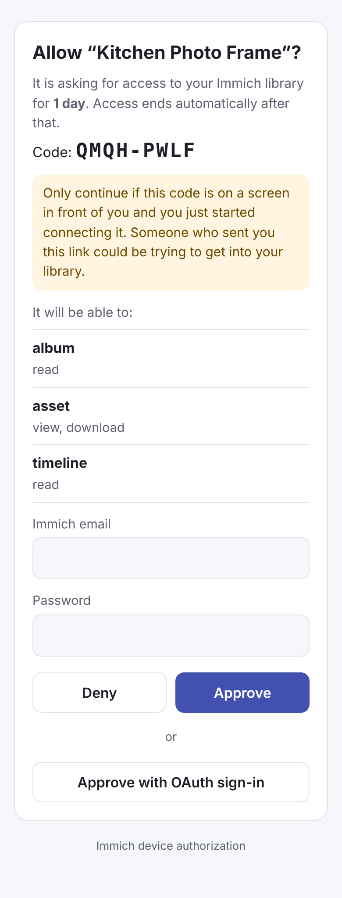
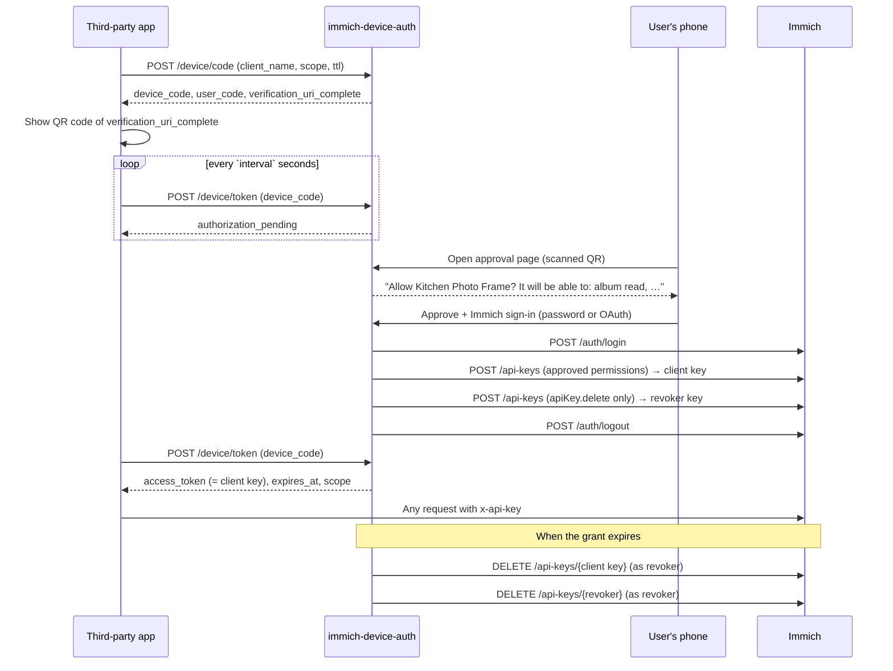

# immich-device-auth

Proof of concept: let third-party Immich apps get a **scoped, expiring** API key
by showing a QR code, instead of asking users to paste a never-expiring key.

<p align="center">
  <picture>
    <source media="(prefers-color-scheme: dark)" srcset="docs/approval-dark.png">
    
  </picture>
  <br><em>What the user sees after scanning the QR code</em>
</p>

It's a small service deployed next to Immich that implements the OAuth 2.0
device authorization grant ([RFC 8628](https://www.rfc-editor.org/rfc/rfc8628)),
the flow TVs and CLIs use for "scan this code to sign in". It needs no changes
to Immich; everything goes through Immich's public API.

## How it works



Design choices worth calling out:

- **The app only ever gets the permissions the user approved.** Requests for
  `all`, key/session/auth management, admin, server config, jobs, libraries,
  plugins or workflows are rejected before the user even sees them (see
  `FORBIDDEN_PERMISSIONS` in `src/config.ts`).
- **No full-access credential outlives the approval.** The login session is
  logged out right after the keys are minted. To delete the client key later,
  the broker keeps a second key that can *only* delete keys, and that key
  deletes itself once it's done.
- **The client key's secret is never stored**, only its SHA-256, so the client
  can revoke early.
- **Keys are visible in Immich.** They appear in the user's API key list named
  like `Kitchen Photo Frame · device grant · expires 2026-11-06 19:00 UTC`, so
  users can revoke them from Immich too. The broker handles that gracefully.
- **Abandoned approvals are cleaned up.** If the user approves but the app
  never collects the key before the device code expires, the key is revoked.
- **Pending requests live in memory; issued grants persist** in SQLite (Node's
  built-in `node:sqlite`, no native dependencies), so expiry survives restarts.

## Try it locally (no Immich needed)

```sh
npm install
npm run mock-immich                    # fake Immich on :2283, user demo@immich.app / demo
IMMICH_URL=http://localhost:2283 OAUTH_ENABLED=true npm run dev   # broker on :3080
REVOKE_AFTER=1 npm run demo            # prints a QR code; approve it in a browser
npm test                               # 17 end-to-end tests against the mock
```

Against a real Immich, point `IMMICH_URL` at it and set `PUBLIC_URL` to the
address phones will use to reach the broker.

## API for client apps

**`POST /device/code`** (form-encoded or JSON)

| Field | |
|---|---|
| `client_name` | Shown to the user and used in the key name. 1–60 characters. |
| `scope` | Space-separated Immich permissions, e.g. `album.read asset.view`. Or `permissions` as a JSON array. |
| `ttl` | Requested key lifetime in seconds (min 60). Capped at `MAX_TTL_SECONDS`. |

Returns `device_code`, `user_code`, `verification_uri`,
`verification_uri_complete`, `verification_uri_complete_qr` (an SVG of the QR
code, for apps that can't draw one), `expires_in`, `interval`, `scope`,
`token_ttl`.

**`POST /device/token`** with `grant_type=urn:ietf:params:oauth:grant-type:device_code`
and `device_code`. Standard RFC 8628 errors: `authorization_pending`,
`slow_down`, `access_denied`, `expired_token`. On success:

```json
{
  "access_token": "<Immich API key secret>",
  "token_type": "immich_api_key",
  "expires_in": 3600,
  "expires_at": "2026-11-05T20:00:00.000Z",
  "scope": "album.read asset.view",
  "immich_url": "https://photos.example.com"
}
```

Use `access_token` as the `x-api-key` header against `immich_url`.

**`POST /device/revoke`** with `token=<access_token>` to end access early.
Always answers 200.

## Configuration

| Variable | Default | |
|---|---|---|
| `IMMICH_URL` | required | Immich as reachable from the broker (without `/api`). |
| `IMMICH_PUBLIC_URL` | `IMMICH_URL` | Immich URL handed to apps. |
| `PUBLIC_URL` | `http://localhost:3080` | Broker URL phones open. |
| `PORT` | `3080` | |
| `DATABASE_PATH` | `./data/device-auth.db` | |
| `DEFAULT_TTL_SECONDS` / `MAX_TTL_SECONDS` | 1 hour / 7 days | Key lifetime. |
| `DEVICE_CODE_TTL_SECONDS` | 600 | How long a QR code stays valid. |
| `POLL_INTERVAL_SECONDS` | 5 | |
| `SWEEP_INTERVAL_SECONDS` | 30 | How often expired keys are deleted. |
| `OAUTH_ENABLED` | `false` | Offer OAuth sign-in on the approval page. |
| `TRUST_PROXY` | `false` | Use `X-Forwarded-For` for rate limiting. |
| `MAX_CODE_LOOKUP_FAILURES` | 20 | Wrong codes per IP per 10 minutes. |
| `MAX_LOGIN_FAILURES` | 5 | Wrong passwords before a request is cancelled. |
| `IMMICH_NATIVE_KEY_EXPIRY` | `false` | See below. |

### OAuth sign-in

The broker asks Immich to start OAuth with
`redirectUri = PUBLIC_URL/device/oauth/callback`. That URI has to be added to
the allowed redirect URIs in the identity provider, next to the ones Immich
already needs.

## Security notes

- Users type their Immich password into the broker, so it should be deployed by
  the Immich admin, behind HTTPS, ideally on the same domain as Immich. A broker
  run by a third party would see passwords; that's the main reason this belongs
  inside Immich long-term.
- Device-flow phishing is a known risk with RFC 8628: an attacker starts a
  request and sends the victim the link. The approval page warns about this and
  shows the code so users can compare it with their screen.
- Approval pages can't be framed (`frame-ancestors 'none'`), aren't cached, and
  carry a per-request form token.
- If the broker is down when a key expires, the key keeps working until the
  broker comes back. Only Immich-side expiry fixes that (next section).

## Toward upstream

This would be simpler and safer inside Immich. Each workaround here maps to a
missing feature:

| Workaround in this PoC | What Immich could provide |
|---|---|
| Sweeper deletes keys on expiry; revoker key | `expiresAt` on API keys ([discussion #32325](https://github.com/immich-app/immich/discussions/32325)). Set `IMMICH_NATIVE_KEY_EXPIRY=true` once it exists: the broker sends `expiresAt` on both keys and Immich enforces expiry even if the broker is down. The field name is a guess and may need adjusting. |
| Separate service, password typed into it | A device-authorization endpoint and approval screen in Immich's web app, reusing the existing session. |
| Forbidden-permission list | A server-defined set of permissions third-party apps may request. |
| Key name carries the client and expiry | "Connected apps" metadata on keys (client name, created via, expiry). |

### Not yet verified against a real Immich

The mock mirrors the Immich v3 API from `@immich/sdk` 3.3.6, but these
behaviours should be confirmed on a live server:

- a key with only `apiKey.delete` can delete itself;
- deleting a nonexistent key returns 400 (`API Key not found`), which the broker
  treats as already deleted;
- `Authorization: Bearer <accessToken>` works for `POST /api-keys` and
  `POST /auth/logout` right after `POST /auth/login`;
- OAuth `redirectUri` values other than Immich's own are accepted.
